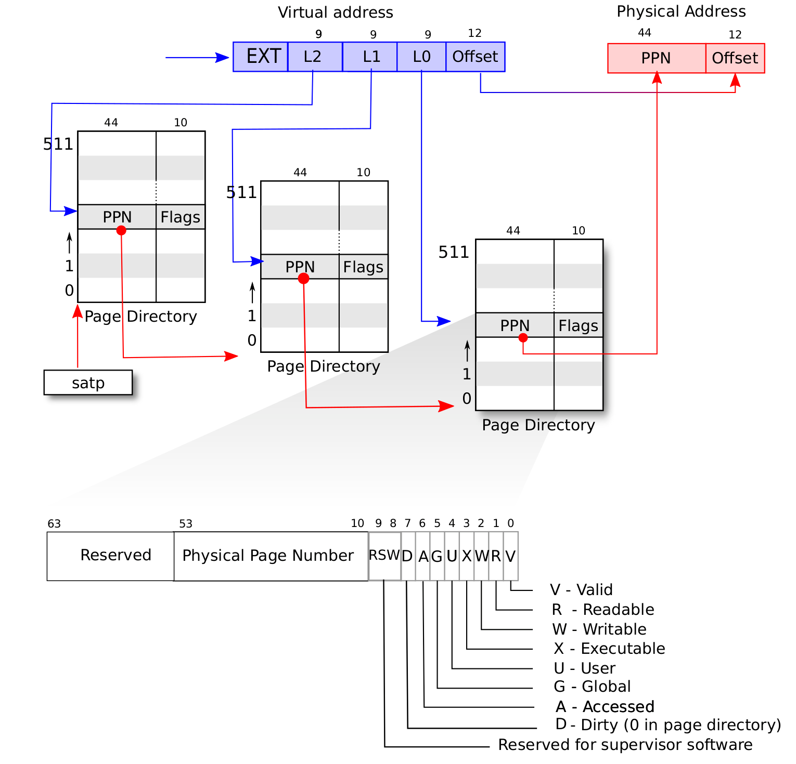
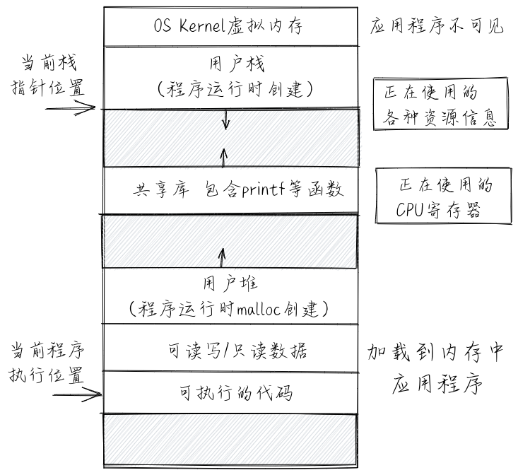
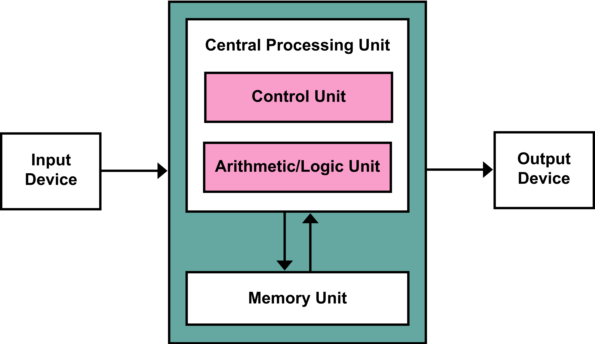
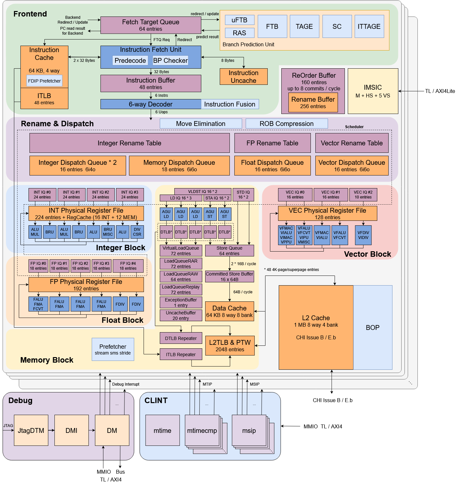

> [!NOTE]
> 本文原始 Jupyter Notebook 及配套实验代码已打包归档，读者可通过以下链接下载源文件并在 Linux 环境下本地复现：[Pointers2ComputerSystems.tar.gz](https://raw.githubusercontent.com/HEU-CS-DPhD/heu-cs-dphd.github.io/master/static/posts_data/Pointers2ComputerSystems/Pointers2ComputerSystems.tar.gz)

> **写在前面**：  
> 如果你刚学完大学第一门编程课《C 语言程序设计》, 你一定掌握了变量、循环、函数、结构体, 甚至与"终极大 Boss"——**指针**交过手.  
> 在 C 语言的视角下, 计算机的世界似乎非常简单直接：
> - 代码写在 `.c` 文件里, 按顺序或者分支一行行执行；
> - 变量被存放在"内存"中, 每个变量都有一个地址；
> - 指针保存的就是这个地址, 解引用 `*p` 就是直接读写那块内存；
> - CPU 负责算术与逻辑运算.
> 
> **但你有没有想过：你所看到的这个"规整、听话、为你独占"的计算机, 真的是真实的物理硬件吗？**  
> 为什么两个同时运行的程序不会互相篡改内存？如果两个程序把指针指向同一个绝对地址会发生什么？如果某个程序写了死循环, 为什么你的鼠标还能动、音乐还在播放？  
> 
> 从这一章开始, 我们将推开计算机系统的"底层大门", 从你最熟悉的 **C 语言指针** 出发, 穿透操作系统的迷雾, 看看现代计算机系统究竟是如何运转的.

# 第一章：从指针到虚拟内存与操作系统

## 1. 先从一个指针开始

在 C 语言中, 大家一定都知道：

```c
int a = 42;
int *p = &a;
printf("变量 a 的地址是: %p, 存放的值是: %d\n", p, *p);
```

此时你的脑海中大概会浮现出这样一个画面：
- 计算机的主板上插着一根或多根内存条(DDR),它们被编上了连续的物理序号(`0x00000000` 到 `0xFFFFFFFF...`);
- 变量 `a` 恰好被分配在其中的某几个记忆单元里；
- 指针 `p` 里存的那个 `0x7ffee...`, 就是这根**真实物理内存条上的物理地址**.

这个模型非常符合直觉, 但是我们再仔细思考一下呢:

1. **多任务冲突问题**：现代电脑(Windows、macOS、Linux)同时运行着几十甚至上百个程序——你的浏览器开着十几个网页、后台在播网易云音乐、微信在接收消息, 而你正在终端里运行自己写的 C 程序.如果大家都在直接操作真实的物理内存条, 为什么微信的变量不会恰好和你的 C 程序变量分到同一个物理地址上？万一碰巧一样, 岂不是后写入的数据瞬间覆盖先写入的数据?
2. **安全性与隔离问题**：在 C 语言中, 指针是可以随意赋值的, 如果你写出这样一行代码：
   ```c
   int *hack = (int *)0x00100000;
   *hack = 0; // 往这个内存地址写 0
   ```
   如果这是物理内存, 你岂不是可以随意遍历整个物理内存条, 直接窃取隔壁微信里正在解密的聊天记录, 甚至直接把操作系统的核心代码清零, 导致电脑瞬间死机?
3. **物理容量限制问题**：如果你的电脑只有 8GB 物理内存, 而一个程序需要 4GB, 另一个也需要 6GB, 两个程序能同时打开吗?

但是大家写代码的时候, 显然不需要担心以上问题.

### 一个小实验：当两个并发程序访问同一个"地址"

我们用代码来验证一下, 两个独立的程序, **同时向同一个一模一样的内存地址写入不同的数据**, 会发生什么, 我们预想的可能是: 后写入的会覆盖先写入的数据.

我们来设计这个实验：
1. 编写两个独立的 C 语言程序：`a.c` 和 `b.c`.
2. 通过某种手段获得指针 `a`（指向 `0x800000`）;
3. 程序 `a.exe` 和 `b.exe` 都往 `0x800000` 处写入一组数列, 但是互不相同, 然后都调用 `sleep(1)` 主动休眠 1 秒钟.
4. 1 秒后, `a.exe`, `b.exe` 睡醒, 重新读取 `0x800000` 处的数据并打印出来.

> [!TIP]
> **先做个预测**：在 1s 之后，后醒来的程序输出的数据一定和先醒来的程序输出内容一样，即 `a.exe` / `b.exe` 中一定有一个程序的数据被覆盖了。

实验代码位于 `code/1-virtual-memory-test/` 目录下：

`code/1-virtual-memory-test/a.c`：

```c
#include <stdint.h>
#include <stdio.h>
#include <unistd.h>
#include <sys/mman.h>

#define ESCAPE_CODE "\x1b[31m"
#define log_printf(fmt, ...) do { printf(ESCAPE_CODE fmt "\x1b[0m", ##__VA_ARGS__); fflush(stdout); } while(0)

void* base_addr = (void*)(0x800000);

int main() {
    setvbuf(stdout, NULL, _IONBF, 0); // 关闭标准输出流缓冲，确保并发日志即时刷新
    FILE* fp = fopen("./a.txt", "r+");
    int *a = (int*)mmap(base_addr, 4096, PROT_READ | PROT_WRITE, MAP_SHARED, fileno(fp), 0);
    fclose(fp);

    log_printf("[a.exe] a = %p\n", a);
    log_printf("[a.exe] a[]:");
    for (int i = 0; i < 10; i++) {
        a[i] = i * i;
        log_printf("%4d", a[i]);
    }
    putchar('\n');
    
    log_printf("[a.exe] sleep 1 sec...\n");
    sleep(1);
    
    log_printf("[a.exe] a[]:");
    for (int i = 0; i < 10; i++) {
        log_printf("%4d", a[i]);
    }
    putchar('\n');

    return 0;
}
```

`code/1-virtual-memory-test/b.c`：

```c
#include <stdint.h>
#include <stdio.h>
#include <unistd.h>
#include <sys/mman.h>

#define ESCAPE_CODE "\x1b[34m"
#define log_printf(fmt, ...) do { printf(ESCAPE_CODE fmt "\x1b[0m", ##__VA_ARGS__); fflush(stdout); } while(0)

void* base_addr = (void*)(0x800000);

int main() {
    setvbuf(stdout, NULL, _IONBF, 0); // 关闭标准输出流缓冲，确保并发日志即时刷新
    FILE* fp = fopen("./b.txt", "r+");
    int *b = (int*)mmap(base_addr, 4096, PROT_READ | PROT_WRITE, MAP_SHARED, fileno(fp), 0);
    fclose(fp);

    log_printf("[b.exe] b = %p\n", b);
    log_printf("[b.exe] b[]:");
    for (int i = 0; i < 10; i++) {
        b[i] = i + i;
        log_printf("%4d", b[i]);
    }
    putchar('\n');
    
    log_printf("[b.exe] sleep 1 sec...\n");
    sleep(1);
    
    log_printf("[b.exe] b[]:");
    for (int i = 0; i < 10; i++) {
        log_printf("%4d", b[i]);
    }
    putchar('\n');

    return 0;
}
```

`code/1-virtual-memory-test/makefile`：

```makefile
.DEFAULT: run
.PHONY: run

CC_FLAG := -O2 -Wall

%.exe: %.c
	$(CC) $^ -o $@ $(CC_FLAG)

run: a.exe b.exe
	@ dd if=/dev/zero of=./a.txt bs=512k count=1 &>/dev/null
	@ dd if=/dev/zero of=./b.txt bs=512k count=1 &>/dev/null
	@ bash -c "./a.exe & ./b.exe; wait"
	
clean: 
	@rm ./*.txt ./*.exe -f -r
```

下面的命令将编译并并发运行 `1-virtual-memory-test/` 目录下的 `a/b` 两个程序. 让我们看看会发生什么：

```bash
cd code/1-virtual-memory-test
make clean
make run
```

参考输出：

```text
cc a.c -o a.exe -O2 -Wall
cc b.c -o b.exe -O2 -Wall
[a.exe] a = 0x800000
[b.exe] b = 0x800000
[a.exe] a[]:[b.exe] b[]:   0   0   1   2   4   4   9   6  16   8  25  10  36  12  49  14  64  16  81  18

[b.exe] sleep 1 sec...
[a.exe] sleep 1 sec...
[a.exe] a[]:[b.exe] b[]:   0   0   2   4   1   6   4   8   9  10  16  12  25  14  36  16  49  18  64  81
```

### 实验现象分析：

观察上面的运行输出, 我们会发现：

- a.exe 与 b.exe 运行的 **时间** 和 **地址** 都有重叠, 但是两者并没有相互影响.

> [!IMPORTANT]
> **操作系统的"抽象"**：说明有"人"帮我们处理了这种冲突，使得每个应用程序都可以假设自己完整占用了一台计算机硬件，从而简化了软件的开发，而这个"人"便是操作系统。操作系统向应用软件提供了一个硬件的"抽象"——**抽象**这两个字会贯穿整个计算机世界，我们在下一章也会继续看到它。

## 2. 虚拟内存(Virtual Memory)

我们继续回到问题上: 为什么两个程序使用数值一模一样的地址 `0x800000`, 却读写着完全不同的数据?

这是因为**操作系统(Operating System, OS)**在硬件(CPU)的配合下, 为每一个正在运行的程序(称为**进程 Process**)提供了独立的内存视图, 一般称作 **虚拟地址空间**.

### 2.1. 虚拟地址空间(Virtual Address Space)

操作系统给每一个进程营造了一个假象:
- 应用程序独占了整台电脑全部的内存, 而且这块内存是巨大、平坦、连续的
- 在 x86_64 上指针类型的宽度一般是 64bits, 这说明这个巨大、平坦、连续的空间, 至多可以是 $2^{64}$ bytes, 我们可以简单测试一下

`pointer_size.c`：

```c
#include <stdio.h>
#include <stdint.h>

int main() {
    printf("sizeof(void*)     = %zx\n", sizeof(void*));
    printf("sizeof(uint64_t*) = %zx\n", sizeof(uint64_t*));
    printf("sizeof(uint32_t*) = %zx\n", sizeof(uint32_t*));
    return 0;
}
```

编译并运行：

```bash
gcc pointer_size.c -o pointer_size.exe
./pointer_size.exe
```

参考输出：

```text
sizeof(void*)     = 8
sizeof(uint64_t*) = 8
sizeof(uint32_t*) = 8
```

无论什么类型的指针, 宽度都是 8bytes, 即 64bits.

虽然指针类型中存放的是地址, 但是指针的宽度并不一定等于操作系统/CPU规定的地址宽度, 我们可以通过下面的命令测试一下 CPU 的虚拟地址宽度:

```bash
lscpu | head -n 10
```

参考输出：

```text
Architecture:                            x86_64
CPU op-mode(s):                          32-bit, 64-bit
Address sizes:                           48 bits physical, 48 bits virtual
Byte Order:                              Little Endian
CPU(s):                                  16
On-line CPU(s) list:                     0-15
Vendor ID:                               AuthenticAMD
Model name:                              AMD Ryzen 9 7940H w/ Radeon 780M Graphics
CPU family:                              25
Model:                                   116
```

> [!NOTE]
> **指针宽度不等于实际虚拟地址宽度**：从输出中可以看到 *48 bits physical, 48 bits virtual*（常见的虚拟地址宽度还有 39 bits 和 57 bits）。这说明 64 bits 的指针中，实际只有低 48 bits 用于存放有效地址——即便如此，每个应用程序也依然获得了 **256 TB** 的平坦虚拟地址空间。

## 3. 页表与 MMU

既然每个进程都拥有各自独立的虚拟地址空间, 而且不同进程可以使用相同的虚拟地址(如前文实验中的 `0x800000`), 那么 CPU 在执行指令时, 是如何将虚拟地址转换为真实的物理内存地址的？

这套机制由**操作系统内核**与 **CPU 内部硬件(MMU)** 协同完成.

### 3.1. 分页机制(Paging)与地址划分

内存并非按字节逐一建立映射(否则元数据开销过大), 而是以固定大小的块进行管理, 这个块称为**页(Page)**.
现代体系结构(x86-64 / ARM64 / RISC-V)中最基本的页大小通常是 **4KB**($4096 = 2^{12}$ 字节).

以 48 位虚拟地址为例, 一个虚拟地址在逻辑上被拆分为两部分：

| 虚拟页号 (VPN, 36 bits) | 页内偏移 (Offset, 12 bits) |
| :-: | :-: |
| 高 36 位（bits 47..12） | 低 12 位（bits 11..0） |

- **页内偏移(Offset, 低 12 位)**：在 4KB 的页内精确定位某一个字节($2^{12} = 4096$).虚拟页和映射后的物理页, 其页内偏移完全相同, **无需转换, 直接透传**.
- **虚拟页号(VPN, Virtual Page Number, 高 36 位)**：表示当前地址属于第几个虚拟页.地址转换的核心任务, 就是把 **VPN 翻译成物理页号(PPN)**.

### 3.2. 页表(Page Table)与页表项(PTE)

为了记录 VPN 到 PPN 的映射关系, 操作系统为 **每个进程** 在内存中维护了一张映射表, 称为**页表**.

页表中的每一个条目称为**页表项(Page Table Entry, PTE)**, 通常为 64 bits(8 bytes), 主要包含两部分信息：
1. **物理页号(PPN, Physical Page Number)**：该虚拟页映射到的物理内存页框基地址.
2. **状态与权限标志位**: 读/写/执行/特权等级等

页表结构如下, 以 39bits 的三级页表为例, 四级页表多加一个 level 即可:



### 3.3. MMU 与硬件地址转换

如果由操作系统写软件代码去查表转换地址, 每次 C 语言读写指针都会增加数十条指令开销, 性能完全无法接受.因此, **地址转换是由 CPU 内部的专用硬件——MMU(Memory Management Unit, 内存管理单元)完成的**.

MMU 的工作流程：
1. CPU 执行访存指令(如 `*p = 10`), 发出虚拟地址.
2. MMU 读取 CPU 内部的**页表基地址寄存器**(x86 架构为 `CR3`, RISC-V 架构为 `satp`), 获取当前进程顶级页表的物理基地址.
3. MMU 硬件自动遍历多级页表, 找到对应的页表项(PTE).
4. **权限校验**：MMU 校验 PTE 上的标志位(R/W、U/S 等).如果不满足当前执行权限, MMU 直接向 CPU 触发异常.
5. 校验通过后, MMU 取出 PPN, 拼接上低 12 位 Offset, 合成真实的物理地址并送上内存总线.

### 3.4. 一些额外的用途：缺页异常(Page Fault)

当 MMU 在查表过程中发现目标页表项的有效位为 0, MMU 会主动向 CPU 发起一个 **硬件异常——缺页异常(Page Fault)**.

CPU 硬件立即暂停当前指令执行, 将控制权转交给操作系统内核预先注册的缺页中断处理程序.操作系统会根据具体情况处理：

1. **按需分配(Demand Paging / 惰性分配)**：  
   在 C 语言中调用 `malloc(100MB)` 或 `mmap` 时, 操作系统为了性能, 并不会真正立刻分配 100MB 的物理内存, 而仅仅是在虚拟地址空间中做个记号.直到程序第一次读写该内存时, 触发缺页异常, 操作系统才真正去分配一个 4KB 物理页框, 填入 PTE 并置 Present 为 1, 随后让程序无缝重新执行刚才的访存指令.应用程序对此毫无感知.
2. **页面置换(Swap / Paging)**：  
   当物理内存吃紧时, 操作系统把暂时不用的物理页数据写入磁盘的 Swap 分区, 并将 PTE 的 Present 置为 0.当程序再次访问该页时触发缺页异常, 操作系统再从磁盘把数据读回物理内存.
3. **非法访问(Segmentation Fault)**：  
   如果访问的虚拟地址根本未被程序映射(如解引用 `NULL` 空指针 `*(int*)0 = 1;`), 或者试图向只读页写数据, 操作系统判断为非法操作, 向该进程发送 `SIGSEGV` 信号, 强制终止进程(即常见的"段错误").

# 第二章：应用程序执行环境栈


在第一章中, 我们建立了操作系统的基本世界观：操作系统将物理硬件(CPU、内存)**抽象** 为虚拟资源(进程、虚拟内存空间)提供给应用程序.

但在实际开发中, 我们写的 C 语言代码并不是直接跨越到操作系统的.现代计算机系统存在一个分层的**执行环境栈**：

1. **用户应用(User Application)**：开发者编写的业务逻辑(如 `main.c`).
2. **C 运行时库(libc / runtime)**：用户态的基础库(如 Linux 下的 glibc), 封装了内存池分配器(`malloc/free`)、标准 I/O 缓冲(`printf/fopen`)以及进程初始化流程.
3. **操作系统的系统调用(OS Syscalls)**：用户态进入内核态的唯一合法大门.内核负责真正的硬件资源抽象和特权操作(如 `brk`, `mmap`, `write`).
4. **硬件平台(Hardware Platform)**：物理 CPU(含 MMU)、内存条(DRAM)以及各类外设.

这一章, 我们将通过系统调用追踪工具 **`strace`**(底层基于 `ptrace`)透视这套调用链, 重点观察**内存管理**在上述各个层次中的具体表现.

## 1. 从 Hello World 开始

想必大家写的第一个 C 语言程序都是 `HelloWorld`, 对于上手任何编程语言来说, `HelloWorld` 都是入门的第一课程. 此时我们可能就会认为, 作为第一课的 `HelloWorld` 想必应该非常简单才对.

我们可以直接使用 Linux 下经典的系统调用追踪工具 **`strace`**(其底层基于内核提供的 `ptrace` 系统调用机制), 来拦截并打印程序运行过程中发起的所有系统调用.

为了排除动态链接器(`ld-linux.so` 寻找和加载 `.so` 动态库带来的一堆辅助调用), 我们使用 **静态链接(`-static`)** 编译该程序, 只观察最核心的调用过程.

`code/2-execution-environment-stack/0_hello.c`：

```c
#include <stdio.h>

int main() {
    printf("Hello, World!\n");
    return 0;
}
```

`code/2-execution-environment-stack/makefile`：

```makefile
.PHONY: all clean

CC := gcc
CFLAGS := -O2 -Wall -static

all: 0_hello 1_brk 2_mmap 3_mprotect

%: %.c
	$(CC) $(CFLAGS) $< -o $@

clean:
	@rm -f 0_hello 1_brk 2_mmap 3_mprotect
```

编译并使用 `strace` 追踪系统调用：

```bash
cd code/2-execution-environment-stack
make 0_hello
strace ./0_hello
```

参考输出：

```text
>>> [程序输出]:
Hello, World!
>>> [strace 追踪到的系统调用]:
execve("./0_hello", ["./0_hello"], 0x7fff47746a60 /* 66 vars */) = 0
brk(NULL)                               = 0x7323000
brk(0x7323d40)                          = 0x7323d40
arch_prctl(ARCH_SET_FS, 0x73233c0)      = 0
set_tid_address(0x73239e8)              = 6179
set_robust_list(0x73236a0, 24)          = 0
rseq({cpu_id_start=0, cpu_id=RSEQ_CPU_ID_UNINITIALIZED, rseq_cs=NULL, flags=0, node_id=0, mm_cid=0, slice_ctrl={request=0, granted=0, __reserved=0}, __reserved=0}, 32, 0, 0x53053053) = 0
getrandom("\x15\xbb\x63\x9c\xf4\xb2\x68\xf6\x23\xca\x23\x00\x68\x35\xc7\xeb", 16, GRND_NONBLOCK) = 16
prlimit64(0, RLIMIT_STACK, NULL, {rlim_cur=8192*1024, rlim_max=RLIM64_INFINITY}) = 0
getrandom("\x01\x75\x6f\x85\x60\xac\xd0\x93", 8, GRND_NONBLOCK) = 8
readlinkat(AT_FDCWD, "/proc/self/exe", "/tmp/p2cs_run/Pointers2ComputerS"..., 4096) = 81
brk(NULL)                               = 0x7323d40
brk(0x7344d40)                          = 0x7344d40
brk(0x7345000)                          = 0x7345000
mprotect(0x4b5000, 16384, PROT_READ)    = 0
fstat(1, {st_mode=S_IFIFO|0600, st_size=0, ...}) = 0
write(1, "Hello, World!\n", 14)         = 14
exit_group(0)                           = ?
+++ exited with 0 +++
```

观察输出可以发现, 在第一句 `Hello, World!` 打印出来之前(write(1, "Hello, World!\n", 14) 之前), 程序已经向内核发起了十余次系统调用：
- `sys_brk`：glibc 运行时为了初始化自身内部堆内存结构, 向内核索要初始堆空间.
- `sys_arch_prctl` / `sys_set_tid_address`：设置 CPU 体系结构相关的线程寄存器(FS 基地址, 用于线程局部存储 TLS).
- `sys_getrandom`：向内核获取随机数, 用于初始化栈溢出金丝雀(Stack Canary)等安全机制.
- `sys_write`：直到最后调用 `printf`, 底层才发起真正的写操作, 向文件描述符 1(标准输出 stdout)写入 14 个字节(`Hello, World!\n`).

> [!IMPORTANT]
> **用户态程序是高度受限的**：没有操作系统和 libc runtime 在底层的支撑，哪怕是最简单的 `Hello, World!` 程序，也连向屏幕输出一个字符都无法做到。

## 2. 内存系统在环境栈中的三个层次

接下来, 我们紧扣内存这一核心主题, 通过三个对比实验, 观察内存操作在执行环境栈中的三个不同层次.

在深入分析系统调用之前, 我们需要先建立起一个进程在**虚拟地址空间中的内存组织视图**.

### 2.1. 进程的内存布局与堆栈关系



在 64 位 Linux 系统中, 操作系统为每个进程规划了清晰规整的虚拟内存布局(从低地址到高地址)：

1. **保留区(Reserved / NULL 指针陷阱区)**：
   - 靠近 `0x0` 地址的一小段区域不建立任何页表映射.任何访问 `NULL`(地址为 0)的指针解引用, 都会因 MMU 查表失败立即触发 `SIGSEGV`, 形成天然的越界保护屏障.
2. **代码段(Text Segment, `.text`)与数据段(Data / BSS)**：
   - `.text`：存放编译后的可执行机器指令, 通常标记为只读且可执行(`RX`).
   - `.rodata`：只读常量数据(如字符串字面量 `"Hello, World!\n"`), 标记为只读(`R`).
   - `.data`：已初始化的全局变量和静态变量, 标记为可读写(`RW`).
   - `.bss`：未初始化的全局变量和静态变量.内核只记录其长度, 在加载时通过缺页异常清零分配, 不占用实际可执行文件的磁盘存储.
3. **堆(Heap)**：
   - 紧随 BSS 段之后, **自低地址向高地址向上增长**.
   - 供程序员动态分配(`malloc` / `free`), 生命周期由开发者掌控.
   - 堆的当前最高合法边界由一个称为 **`program break`** 的指针标记.
4. **内存映射段(Memory Mapping Segment / mmap 区)**：
   - 位于堆与栈之间的广阔区域, 用于动态加载共享库(如 `libc.so`), 也是 `mmap` 系统调用映射匿名内存或文件的专属区域.
5. **栈(Stack)**：
   - 位于用户空间的最高地址端, **自高地址向低地址向下增长**.
   - 存放函数的局部变量、调用参数以及返回地址, 由 CPU 硬件栈指针寄存器(RSP)直接维护, 分配与释放极快.

> [!TIP]
> **堆与栈的对向生长设计**：  
> 堆自底向上、栈自顶向下，两者相对而生。这种经典设计使堆和栈能够共享中间广阔的未分配虚拟空间，任意一方需要更多空间时只需向中间空闲区域延伸，最大化了动态空间的利用效率。

---

### 2.2. libc 函数调用：`malloc`

内存空间中的堆是一块连续的内存区域, 软件可以通过 brk 系统调用来扩大这块区域的空间. 如当前 heap 指针为 0x2000, 调用 brk(0x3000), 则操作系统会将堆顶推到 0x3000 位置, 从而软件可以得到 4k 的堆区空间. 堆区的用途是服务动态内存分配, 程序可以在执行的任意时刻, 向操作系统申请内存.

那么我们此时如果简单的假设: 软件直接运行在操作系统上, 那么我们可能会得到一个结论: **"每次调用 `malloc(32)`, 操作系统内核就会为我分配 32 字节的物理内存"**.

事实真的如此吗？我们看 `code/2-execution-environment-stack/1_brk.c`：

```c
#include <stdio.h>
#include <stdlib.h>
#include <unistd.h>

int main() {
    printf("[App] Start: malloc(32) x 10 in a loop...\n");
    fflush(stdout);
    for (int i = 0; i < 10; i++) {
        void *p = malloc(32);
        (void)p;
    }
    printf("[App] Done: 10 small mallocs finished.\n");
    return 0;
}
```

我们用 `strace` 来追踪它, 看看循环内到底产生了多少次内核调用：

```bash
cd code/2-execution-environment-stack
make 1_brk
strace ./1_brk
```

参考输出：

```text
>>> [程序输出]:
[App] Start: malloc(32) x 10 in a loop...
[App] Done: 10 small mallocs finished.
>>> [strace 追踪到的系统调用]:
execve("./1_brk", ["./1_brk"], 0x7ffe12330330 /* 66 vars */) = 0
brk(NULL)                               = 0x8195000
brk(0x8195d40)                          = 0x8195d40
arch_prctl(ARCH_SET_FS, 0x81953c0)      = 0
set_tid_address(0x81959e8)              = 6188
set_robust_list(0x81956a0, 24)          = 0
rseq({cpu_id_start=0, cpu_id=RSEQ_CPU_ID_UNINITIALIZED, rseq_cs=NULL, flags=0, node_id=0, mm_cid=0, slice_ctrl={request=0, granted=0, __reserved=0}, __reserved=0}, 32, 0, 0x53053053) = 0
getrandom("\x09\x8c\x75\x75\xa9\xc9\xbf\x0b\x07\x6e\x86\x7d\xe2\x3b\x0b\x78", 16, GRND_NONBLOCK) = 16
prlimit64(0, RLIMIT_STACK, NULL, {rlim_cur=8192*1024, rlim_max=RLIM64_INFINITY}) = 0
getrandom("\x9d\xac\xed\x5f\x37\xcc\xb2\xb3", 8, GRND_NONBLOCK) = 8
readlinkat(AT_FDCWD, "/proc/self/exe", "/tmp/p2cs_run/Pointers2ComputerS"..., 4096) = 79
brk(NULL)                               = 0x8195d40
brk(0x81b6d40)                          = 0x81b6d40
brk(0x81b7000)                          = 0x81b7000
mprotect(0x4b5000, 16384, PROT_READ)    = 0
fstat(1, {st_mode=S_IFIFO|0600, st_size=0, ...}) = 0
write(1, "[App] Start: malloc(32) x 10 in "..., 42) = 42
write(1, "[App] Done: 10 small mallocs fin"..., 39) = 39
exit_group(0)                           = ?
+++ exited with 0 +++
```

#### 运行结果分析: malloc 调用并不直接和操作系统交互

在上面输出中, 进入循环后连续 10 次 `malloc(32)`, **内核层面没有产生任何额外的 `brk` 系统调用**. 再仔细思考一下的话, 我们可以在运行时 free 一块内存, 但是 heap 区域是单端伸缩的, 如果一块区域不在 heap 的边界上, 此时执行 free, 操作系统并没有办法实际收回这块内存.

> [!IMPORTANT]
> **核心结论**：
> - **`malloc` 不是系统调用**：它是 libc runtime（glibc ptmalloc）在用户态实现的内存池算法。
> - **批发与零售**：libc 提前通过 `brk` 向内核"批发"一块较大的堆空间（例如数十 KB 或上百 KB，向上推高 break 指针），然后在用户态内存池中把这块空间切分成 32 字节的小块"零售"给应用。这一层完全由 **libc runtime** 处理，操作系统内核根本无需介入。

---

### 2.3. 系统调用：`mmap`: 向操作系统请求虚拟地址空间

既然小内存可以通过 libc 的堆内存池批发, 那么如果应用程序需要申请一块很大的内存(例如 1MB 甚至几百 MB)呢？

如果还用 `brk` 把整个堆往上顶, 大块内存释放时由于低地址可能还有小对象在使用, 堆顶无法向下收缩, 容易造成极其严重的**内存碎片**.

因此, libc 对大块内存采取了另一套策略：**绕过堆内存池, 直接向操作系统发起 `mmap` 系统调用**. 该系统调用用于在 heap 区域外, 单独的 mmap 区域分配一块独立的地址.

查看 `code/2-execution-environment-stack/2_mmap.c`：

```c
#include <stdio.h>
#include <stdlib.h>
#include <unistd.h>

int main() {
    // 获取 SP 指针
    void *sp;
    __asm__("mov %%rsp, %0" : "=r"(sp));
    printf("[App] Stack pointer (RSP) = %p\n", sp);

    printf("[App] Requesting 1MB large memory (exceeds MMAP_THRESHOLD)...\n");
    void *p = malloc(1024 * 1024);
    printf("[App] malloc(1MB) done, ptr = %p\n", p);
    printf("[App] Freeing memory via free(p)...\n");
    free(p);
    return 0;
}
```

编译并使用 `strace` 追踪系统调用：

```bash
cd code/2-execution-environment-stack
make 2_mmap
strace ./2_mmap
```

参考输出：

```text
>>> [程序输出]:
[App] Stack pointer (RSP) = 0x7ffe27b8f6e0
[App] Requesting 1MB large memory (exceeds MMAP_THRESHOLD)...
[App] malloc(1MB) done, ptr = 0x701899945010
[App] Freeing memory via free(p)...
>>> [strace 追踪到的系统调用]:
execve("./2_mmap", ["./2_mmap"], 0x7ffd4f5453a0 /* 66 vars */) = 0
brk(NULL)                               = 0xa339000
brk(0xa339d40)                          = 0xa339d40
arch_prctl(ARCH_SET_FS, 0xa3393c0)      = 0
set_tid_address(0xa3399e8)              = 6197
set_robust_list(0xa3396a0, 24)          = 0
rseq({cpu_id_start=0, cpu_id=RSEQ_CPU_ID_UNINITIALIZED, rseq_cs=NULL, flags=0, node_id=0, mm_cid=0, slice_ctrl={request=0, granted=0, __reserved=0}, __reserved=0}, 32, 0, 0x53053053) = 0
getrandom("\x39\x60\xab\x77\x53\xe6\x02\x0f\x69\x17\x56\x72\xa9\x23\xcd\x50", 16, GRND_NONBLOCK) = 16
prlimit64(0, RLIMIT_STACK, NULL, {rlim_cur=8192*1024, rlim_max=RLIM64_INFINITY}) = 0
getrandom("\xfb\x71\x67\x8e\xf0\xaf\x24\x9d", 8, GRND_NONBLOCK) = 8
readlinkat(AT_FDCWD, "/proc/self/exe", "/tmp/p2cs_run/Pointers2ComputerS"..., 4096) = 80
brk(NULL)                               = 0xa339d40
brk(0xa35ad40)                          = 0xa35ad40
brk(0xa35b000)                          = 0xa35b000
mprotect(0x4b5000, 16384, PROT_READ)    = 0
fstat(1, {st_mode=S_IFIFO|0600, st_size=0, ...}) = 0
mmap(NULL, 1052672, PROT_READ|PROT_WRITE, MAP_PRIVATE|MAP_ANONYMOUS, -1, 0) = 0x701899945000
munmap(0x701899945000, 1052672)         = 0
write(1, "[App] Stack pointer (RSP) = 0x7f"..., 186) = 186
exit_group(0)                           = ?
+++ exited with 0 +++
```

#### 运行结果分析: 直接由操作系统分配虚拟内存区域

从程序的输出和 `strace` 追踪可以观察到两个关键现象：

1. **验证内存视图布局(栈 vs mmap 区)**：
   - 打印出的栈顶指针 `RSP` 位于高地址(如 `0x7ffd...`)；
   - `mmap` 返回的大内存指针位于 `0x7...`, 明显低于栈顶地址, 但远高于 `brk` 扩展的低地址堆区(如 `0x...`).这直观印证了前文内存视图中：**mmap 区域介于堆与栈之间的中间空闲地带**.

2. **libc 绕过堆直接调用内核**：
   - `malloc(1MB)` 时, 底层直接触发了 `mmap(...)`, 向内核请求一段大小约为 1MB(1052672 字节)的独立匿名映射(`MAP_ANONYMOUS | MAP_PRIVATE`).
   - `free(p)` 时, 底层立即调用了 `munmap(...)`, 直接将这段虚拟内存区域注销并归还给操作系统内核.

在这一层, libc 不再对内存进行池化缓存, 而是充当一层薄封装, **直接穿透到操作系统的系统调用层**.

---

### 2.4. 硬件平台层：`mprotect`: 请求硬件页保护

最后, 我们看一个最底层的场景：**内存权限保护**.

之前的页表章节, 我们知道了页表项(PTE)中保存了只读、读写、不可执行等权限位.如果应用程序想在运行时初始化一块区域, 并在初始化完成之后设为只读, 防止意外改写, 则可以通过页表来完成, 具体操作为, 通过 `mprotect` syscall 请求操作系统. 当一个内存页的写权限被关闭, pte.W = 0, 此时向该区域写入数据, 会发生 **MemoryStoreFault**, linux 会将这一行为通过 <u>信号(Signal)</u> 机制报告给应用程序, 我们可以通过注册 `sigsegv_handler` 来捕获这个信号:

查看 `code/2-execution-environment-stack/3_mprotect.c`：

```c
#include <stdio.h>
#include <sys/mman.h>
#include <unistd.h>
#include <signal.h>
#include <stdlib.h>

void sigsegv_handler(int sig) {
    printf("[Signal Handler] Caught SIGSEGV (%d)! MMU hardware check failed.\n", sig);
    exit(0);
}

int main() {
    signal(SIGSEGV, sigsegv_handler);

    int *page = (int*)mmap(NULL, 4096, PROT_READ | PROT_WRITE, MAP_ANONYMOUS | MAP_PRIVATE, -1, 0);
    *page = 42;
    printf("[App] Page allocated. Initial write: *page = %d\n", *page);

    printf("[App] Calling mprotect to set page PROT_READ (read-only)...\n");
    fflush(stdout);
    mprotect(page, 4096, PROT_READ);

    printf("[App] Writing to read-only page (will trigger MMU exception)...\n");
    fflush(stdout);
    *page = 100; // triggers hardware MMU exception

    return 0;
}
```

编译并使用 `strace` 追踪系统调用：

```bash
cd code/2-execution-environment-stack
make 3_mprotect
strace ./3_mprotect
```

参考输出：

```text
>>> [程序输出]:
[App] Page allocated. Initial write: *page = 42
[App] Calling mprotect to set page PROT_READ (read-only)...
[App] Writing to read-only page (will trigger MMU exception)...
[Signal Handler] Caught SIGSEGV (11)! MMU hardware check failed.
>>> [strace 追踪到的系统调用]:
execve("./3_mprotect", ["./3_mprotect"], 0x7ffced6e01a0 /* 66 vars */) = 0
brk(NULL)                               = 0x2afda000
brk(0x2afdad40)                         = 0x2afdad40
arch_prctl(ARCH_SET_FS, 0x2afda3c0)     = 0
set_tid_address(0x2afda9e8)             = 6206
set_robust_list(0x2afda6a0, 24)         = 0
rseq({cpu_id_start=0, cpu_id=RSEQ_CPU_ID_UNINITIALIZED, rseq_cs=NULL, flags=0, node_id=0, mm_cid=0, slice_ctrl={request=0, granted=0, __reserved=0}, __reserved=0}, 32, 0, 0x53053053) = 0
getrandom("\xfd\xaa\xe1\xdd\xfa\x1b\xdf\x52\x82\x2f\xe5\xe7\x94\x19\x67\xdc", 16, GRND_NONBLOCK) = 16
prlimit64(0, RLIMIT_STACK, NULL, {rlim_cur=8192*1024, rlim_max=RLIM64_INFINITY}) = 0
getrandom("\x3d\x73\x90\x9d\x18\xa1\x16\x66", 8, GRND_NONBLOCK) = 8
readlinkat(AT_FDCWD, "/proc/self/exe", "/tmp/p2cs_run/Pointers2ComputerS"..., 4096) = 84
brk(NULL)                               = 0x2afdad40
brk(0x2affbd40)                         = 0x2affbd40
brk(0x2affc000)                         = 0x2affc000
mprotect(0x4b5000, 16384, PROT_READ)    = 0
rt_sigaction(SIGSEGV, {sa_handler=0x4030e0, sa_mask=[SEGV], sa_flags=SA_RESTORER|SA_RESTART, sa_restorer=0x406420}, {sa_handler=SIG_DFL, sa_mask=[], sa_flags=0}, 8) = 0
mmap(NULL, 4096, PROT_READ|PROT_WRITE, MAP_PRIVATE|MAP_ANONYMOUS, -1, 0) = 0x773f827ee000
fstat(1, {st_mode=S_IFIFO|0600, st_size=0, ...}) = 0
write(1, "[App] Page allocated. Initial wr"..., 108) = 108
mprotect(0x773f827ee000, 4096, PROT_READ) = 0
write(1, "[App] Writing to read-only page "..., 64) = 64
--- SIGSEGV {si_signo=SIGSEGV, si_code=SEGV_ACCERR, si_addr=0x773f827ee000} ---
write(1, "[Signal Handler] Caught SIGSEGV "..., 65) = 65
exit_group(0)                           = ?
+++ exited with 0 +++
```

#### 运行结果分析: 硬件 MMU 的直接介入

观察 `strace` 的输出：
1. 程序调用 `mprotect(0x..., 4096, PROT_READ) = 0` 将页面改为只读后, 系统调用成功返回.此时操作系统内核的任务已经完成(仅在页表中将写标志位设为 0).
2. 当程序执行 `*page = 100;` 这条普通的汇编写入指令时, **没有任何系统调用产生**！
3. 但 `strace` 立即捕获到一条硬件异常导致的信号事件：  
   `--- SIGSEGV {si_signo=SIGSEGV, si_code=SEGV_ACCERR, si_addr=0x...} ---`  
   其中 `si_code=SEGV_ACCERR` 明确指出了是"权限访问错误(Access Error)".
4. **原理**：
   - CPU 执行写入指令寻址时, 片上硬件 **MMU** 自动检查该虚拟页对应的页表项；
   - MMU 硬件检测到写操作违反了 PTE 只读属性, **直接在硬件电路上触发 Page Fault 异常**；
   - CPU 硬件自动暂停流水线, 跳转到内核预先配置的中断向量；操作系统内核响应硬件异常后, 向引发异常的进程投递 `SIGSEGV` 信号.

> [!WARNING]
> **内存保护的最后一道防线是底层硬件平台**：当程序尝试写入被 `mprotect` 标记为只读的页面时，不会经过任何系统调用，而是由 CPU 片上硬件 **MMU** 直接在指令访存阶段检测到权限违规并触发 Page Fault 异常，再由操作系统内核投递 `SIGSEGV` 信号。

## 本章小结：执行环境栈的全貌

回顾我们在这一章看到的层次：

| 层次 | 对应机制 | 核心职责与表现 |
| :--- | :--- | :--- |
| **用户应用 (User Application)** | C 语言业务代码 | 编写具体的算法与逻辑, 调用 `malloc`、指针解引用. |
| **运行时库 (libc runtime)** | 内存池与运行时管理 (`brk`) | 将内核粗粒度的系统调用转化为轻量级接口, 通过堆内存池批发零售, 避免频繁陷入内核. |
| **操作系统 (OS Syscall)** | 系统调用接口 (`mmap` / `munmap`) | 跨越特权级(Ring 3 $\to$ Ring 0), 为进程创建和销毁独立的虚拟内存区域(VMA). |
| **硬件平台 (Hardware Platform)** | MMU 与页表标志位 (`mprotect` 后硬件异常) | 在每次 CPU 访存指令执行时, 硬件电路强制校验权限位, 一旦违规直接触发硬件中断. |

---

# 第三章：指令集视角下的指针

在前两章中, 我们从宏观上理解了虚拟内存、页表映射以及应用程序执行环境栈：
- **第一章** 了解了虚拟地址空间与 MMU 翻译机制.
- **第二章** 学习了执行环境栈, 理解了应用程序、libc 运行时、操作系统系统调用的分工.

现在, 我们进一步将视角下沉到软硬件交接的层面：
当我们在 C 语言中写下一行简单的指针操作(如 `*p = 10`、`p + 1` 或 `fn(x)`)时, CPU 究竟做了什么？C编译器又是如何把类型、指针等抽象概念, 翻译成底层的机器指令的？

## 1. 从冯·诺伊曼体系结构到寄存器机

在分析具体的汇编代码之前, 我们先回到大一课本, 在脑海中建立起真实的物理硬件模型.

### 1. 课本上的冯·诺伊曼体系结构

大家在大一的《计算机导论》或相关课程中, 一定都见过下面这张经典的冯·诺伊曼体系结构图：


<p style="text-align: center; font-size: 0.85em; color: #64748b; margin-top: 6px;">图 3-1：经典的冯·诺伊曼计算机体系结构</p>

1945 年, 数学家冯·诺伊曼提出了现代计算机的基石——**"存储程序(Stored-Program)"** 原理：
- 程序指令与处理的数据统统存放在同一个**存储器**中；
- 计算机由五大基本部件构成：**运算器(ALU)**、**控制器(CU)**、**存储器(Memory)**、**输入设备**和**输出设备**.

### 2. 现代处理机模型：寄存器机

随着硬件的发展, 处理器单次运算的延迟变得远小于内存读写的延迟, 如果每次操作都从内存中存取操作数, 内存跟不上 CPU 的运算速度. 为了解决这个问题, 芯片设计者在 CPU 芯片内部、紧贴着运算器的地方, 放置了一组容量极小但速度极快的临时存储单元——**通用寄存器(General-Purpose Registers)**.

现代主流计算机都是 **寄存器机(Register Machine)** 模型：
- 运算器不直接在内存中做算术, 必须先将数据从内存"搬进" CPU 核内的寄存器；
- 运算器在寄存器之间高效地完成算术逻辑计算；
- 计算完毕后, 再将结果从寄存器"写回"内存.


<p style="text-align: center; font-size: 0.85em; color: #64748b; margin-top: 6px;">图 3-2：开源高性能 RISC-V 处理器——香山"昆明湖"微架构框图</p>

图 3-2 是中国科学院计算所开源的高性能芯片——香山"昆明湖"架构的内部微架构设计图. 请注意观察图中左侧的寄存器堆 (Physical Register File), 在它的旁边就是算术逻辑单元 (Arithmetic and Logic Unit, ALU), 常见的运算如 add, sub, and 都在这个单元中完成.

## 2. 指令集中的访存

### 1. 指令集是软硬件之间的"契约"

软件开发者希望同样的软件可以在更多的芯片上运行, 芯片研发者则希望保证硬件实现的灵活性, 所以硬件必须要提供一层抽象, 被称作**指令集架构(Instruction Set Architecture, ISA)**. 就像之前操作系统向应用软件提供的抽象一样, 指令集向系统软件提供了对硬件 CPU 的抽象.

- **对硬件而言**：无论芯片内部电路设计如何, 硬件必须保证, 执行指令序列的结果符合 ISA 的约定;
- **对软件而言**：指令集规定了"有多少可用的寄存器"、"有哪些指令可用"、"每条指令执行的效果".

从状态机的视角来看的话: CPU是一个有限状态机, 指令集规定了这个状态机能接受哪些**激励**, 有哪些**状态**, 以及每个激励对应的状态转移规则.

### 2. 简单认识 RISC-V

我们需要选择一个具体的指令集来研究 C 语言指针在硬件底层究竟做了什么. 这里我们选择 **RISC-V** 指令集.

#### 为什么是 RISC-V？

- 传统的 x86 指令集 (常用于个人电脑) 闭源且背负了近半个世纪的历史包袱, 指令格式繁杂；
- 而 RISC-V 是一款现代、开放且完全开源的精简指令集(RISC), 它吸取了以往种种 ISA 的经验, 设计干净整齐, 是当前全世界学生学习计算机体系结构最理想的指令集.

#### RISC-V ISA

我们以 64 位的 RV64I 基本指令集为例. RV64I 拥有 32 个通用寄存器 (`x0` ~ `x31`). 汇编程序员或编译器能直接操作的, 就是 CPU 内部的这 32 个 64 位通用寄存器, 依次编号 `x0` 到 `x31`. 在 RISC-V 汇编中, 它们根据通常的用途有着别名：
- `zero`：第 0 号寄存器是特殊寄存器, 硬件固定恒等于 0, 往 `x0` 的写入是无用的;
- `sp`：栈指针寄存器(我们在第二章见过的运行时栈顶指针);
- `ra`：返回地址寄存器(记录函数调用结束后要返回哪里);
- `a0` ~ `a7`：参数寄存器 (argument), 专门用来传递函数调用参数和接收函数返回值;
- `t0` ~ `t6`：临时寄存器 (temporary), 用于暂存各种中间计算数值;
- `s0` ~ `s11`: 保存寄存器 (saved), 同样用于存放中间计算数值, 与临时寄存器的区别是函数调用前后, 值是否会被保留.

> [!NOTE]
> **RISC-V 的 Load-Store 架构规则**：
> 1. **算术运算只能在寄存器之间进行**：各种算术或位运算的操作数必须是寄存器（例如 `add a0, a1, a2`），不能直接对内存里的变量做运算；
> 2. **内存操作必须通过专门的访存指令**：
>    - **Load（加载）指令**：从指定内存地址把数据读入寄存器；
>    - **Store（存储）指令**：把寄存器里的数据写回到指定内存地址。

## 3. 从 C语言 到 Load 与 Store 指令

我们看 `code/3-isa-and-pointer/1_deref.c` 中的两个小函数：

```c
int load_int(int *p) {
    return *p;
}

void store_int(int *p, int val) {
    *p = val;
}
```

`code/3-isa-and-pointer/makefile`：

```makefile
.PHONY: all clean

CC := riscv64-linux-gnu-gcc
CFLAGS := -O2

SRCS := $(wildcard *.c)
OBJS := $(SRCS:.c=.o)

all: $(OBJS)

%.o: %.c
	$(CC) $(CFLAGS) -c $< -o $@

clean:
	@rm -f *.o
```

使用交叉编译器 `riscv64-linux-gnu-gcc` 将其编译为目标文件 `1_deref.o`, 并使用 `objdump -d` 观察其纯汇编实现：

```bash
cd code/3-isa-and-pointer
make 1_deref.o
riscv64-linux-gnu-objdump -d 1_deref.o
```

参考输出：

```text
1_deref.o:     file format elf64-littleriscv


Disassembly of section .text:

0000000000000000 <load_int>:
   0:	4108                	lw	a0,0(a0)
   2:	8082                	ret

0000000000000004 <store_int>:
   4:	c10c                	sw	a1,0(a0)
   6:	8082                	ret
```

### 硬件视角的指针

观察反汇编结果:

```assembly
0000000000000000 <load_int>:
   0:   lw   a0, 0(a0)
   2:   ret

0000000000000004 <store_int>:
   4:   sw   a1, 0(a0)
   6:   ret
```

进入 `load_int(int *p)` 时, 指针 `p` 存放在寄存器 `a0` 中, 注意 `lw` 指令:
- `offset(base)` 表示寄存器 `base` 中的数值, 加上 `offset`.
- `lw a0, 0(a0)`(Load Word) 从 `a0 + 0` 对应的虚拟地址加载 4 字节数据, 存入 `a0` 作为返回值.

进入 `store_int(int *p, int val)` 时, 指针 `p` 存放在 `a0` 中, `val` 存放在 `a1` 中, 注意 `sw` 指令:
- `sw a1, 0(a0)`(Store Word) 将寄存器 `a1` 里的 4 字节数据, 写到 `a0 + 0` 对应的内存地址 (即指针 `p` 存储的虚拟地址).

> [!IMPORTANT]
> **硬件视角的指针本质**：指针仅仅是保存在通用寄存器中的一个 64 位无符号整数（虚拟内存地址）。所谓"解引用"，就是 CPU 拿着寄存器中存储的值，通过总线和 MMU 硬件发起一次 Load 或 Store 内存操作。

## 4. 类型系统在指令集中的体现

既然指针只是存放在寄存器或内存上的整数, 自然, 寄存器和内存上的数据就没有类型的分别, 类型系统是编程语言提供的规则. C 语言的类型会影响生成的指令, 主要体现在两个方面：

1. **访存指令的位宽**：编译器根据指针指向的数据类型, 替我们挑选了不同位宽的 Load/Store 指令：
   - `lb` (Load Byte)：读 1 字节(`int8_t` / `unsigned char`)
   - `lh` (Load Halfword)：读 2 字节(`int16_t` / `short`)
   - `lw` (Load Word)：读 4 字节(`int32_t` / `int`)
   - `ld` (Load Doubleword)：读 8 字节(`int64_t` / `long long` / 指针)
2. **指针加减运算的步长**：在 C 中写 `p + 1`, 并非总是让地址加 1, 而是将指针指向数据类型的大小作为步长.

查看 `code/3-isa-and-pointer/2_types_and_stride.c`：

```c
#include <stdint.h>

// 1. 访存指令位宽
int8_t  read_i8 (int8_t  *p) { return *p; }
int16_t read_i16(int16_t *p) { return *p; }
int32_t read_i32(int32_t *p) { return *p; }
int64_t read_i64(int64_t *p) { return *p; }

// 2. 指针步长计算
char*   step_char (char   *p) { return p + 1; }
int*    step_int  (int    *p) { return p + 1; }
int64_t* step_i64 (int64_t*p) { return p + 1; }
```

编译并查看反汇编：

```bash
cd code/3-isa-and-pointer
make 2_types_and_stride.o
riscv64-linux-gnu-objdump -d 2_types_and_stride.o
```

参考输出：

```text
2_types_and_stride.o:     file format elf64-littleriscv


Disassembly of section .text:

0000000000000000 <read_i8>:
   0:	00050503          	lb	a0,0(a0)
   4:	8082                	ret

0000000000000006 <read_i16>:
   6:	00051503          	lh	a0,0(a0)
   a:	8082                	ret

000000000000000c <read_i32>:
   c:	4108                	lw	a0,0(a0)
   e:	8082                	ret

0000000000000010 <read_i64>:
  10:	6108                	ld	a0,0(a0)
  12:	8082                	ret

0000000000000014 <step_char>:
  14:	0505                	addi	a0,a0,1
  16:	8082                	ret

0000000000000018 <step_int>:
  18:	0511                	addi	a0,a0,4
  1a:	8082                	ret

000000000000001c <step_i64>:
  1c:	0521                	addi	a0,a0,8
  1e:	8082                	ret
```

观察反汇编的结果：

- **访存位宽**：
  - `read_i8`: `lb a0, 0(a0)` (取 1 字节并符号扩展)；
  - `read_i16`: `lh a0, 0(a0)` (取 2 字节并符号扩展)；
  - `read_i32`: `lw a0, 0(a0)` (取 4 字节并符号扩展)；
  - `read_i64`: `ld a0, 0(a0)` (取满 8 字节).
- **指针运算步长**：
  - `step_char`: `addi a0, a0, 1` (加 1)；
  - `step_int`: `addi a0, a0, 4` (加 4)；
  - `step_i64`: `addi a0, a0, 8` (加 8).

## 5. 函数调用在指令集中的体现

在 C 语言中, 我们经常遇到函数指针：
```c
int (*fn)(int);  // 一个指向函数开始地址的指针, 称作 fn, 该函数的返回值为 int 且参数列表为 (int)  
```

思考一个关键问题：函数指针和普通数据指针在硬件上有区别吗？
- **相同点**: 它们都是纯粹的 64 位无符号整数(地址), 都存在通用寄存器里.
- **不同点**：
  - 数据指针: 往往生成 Load/Store 指令, 读写数据；
  - 函数指针: 往往生成跳转指令, 用来修改 CPU 的程序计数器 (Program Counter, PC), 改变程序的执行流.

### 跳转指令

RISC-V 提供了两条指令:

- `jal rd, offset`(Jump and Link)：跳转地址在编译期是确定的. 将下一条指令的地址 (`PC + 4`) 存入寄存器 `rd`, 然后跳转到 offset 字节之后的位置 (`PC += offset`).
- `jalr rd, offset(rs1)`(Jump and Link Register)：跳转地址是动态的. 将下条指令地址存入 `rd`, 然后跳转到 `rs1 + offset` 的位置 (`PC = rs1 + offset`)

> [!TIP]
> **关于 RISC-V 汇编伪指令（Pseudo-instructions）**：  
> 为了方便汇编书写，RISC-V 在基本指令之上定义了伪指令——硬件上并不存在完全对应的物理指令，而是会由汇编器自动生成等效的指令序列：
> - `ret` 指令等价于 `jalr zero, 0(ra)` —— 即跳回 `ra` 保存的返回地址，并丢弃新的返回地址（写入恒为 0 的 `zero` 寄存器）。
> - 由于保存返回地址的寄存器在多数时候都是 `ra`，因此 `jal` 和 `jalr` 都可以省略 `rd`（默认为 `ra`），例如 `jalr rs1` 等价于 `jalr ra, 0(rs1)`。

查看 `code/3-isa-and-pointer/3_func_ptr.c`：

```c
int target_func(int x);

int call_direct(int x) {
    int res = target_func(x);
    return res + 1;
}

int call_indirect(int (*fn)(int), int x) {
    int res = fn(x);
    return res + 1;
}
```

编译并查看反汇编：

```bash
cd code/3-isa-and-pointer
make 3_func_ptr.o
riscv64-linux-gnu-objdump -d 3_func_ptr.o
```

参考输出：

```text
3_func_ptr.o:     file format elf64-littleriscv


Disassembly of section .text:

0000000000000000 <call_direct>:
   0:	1141                	addi	sp,sp,-16
   2:	e406                	sd	ra,8(sp)
   4:	00000097          	auipc	ra,0x0
   8:	000080e7          	jalr	ra # 4 <call_direct+0x4>
   c:	60a2                	ld	ra,8(sp)
   e:	2505                	addiw	a0,a0,1
  10:	0141                	addi	sp,sp,16
  12:	8082                	ret

0000000000000014 <call_indirect>:
  14:	1141                	addi	sp,sp,-16
  16:	e406                	sd	ra,8(sp)
  18:	87aa                	mv	a5,a0
  1a:	852e                	mv	a0,a1
  1c:	9782                	jalr	a5
  1e:	60a2                	ld	ra,8(sp)
  20:	2505                	addiw	a0,a0,1
  22:	0141                	addi	sp,sp,16
  24:	8082                	ret
```

### 从调用栈到动态跳转

重点观察 `call_indirect` 的反汇编序列：
```assembly
0000000000000014 <call_indirect>:
  14:   addi   sp, sp, -16      # 1. 栈指针下移, 分配 16 字节栈帧
  16:   sd     ra, 8(sp)        # 2. 将当前函数的返回地址 ra 保存到栈上
  18:   mv     a5, a0           # 3. 将函数指针 fn (在 a0 中) 暂存到 a5
  1a:   mv     a0, a1           # 4. 将实际参数 x (在 a1 中) 移至 a0, 作为 fn 的第一个参数
  1c:   jalr   a5               # 5. 跳转到 a5 寄存器里的地址, 并将 PC+4 写入 ra
  1e:   ld     ra, 8(sp)        # 6. 被调用函数返回后, 从栈中恢复原 ra
  20:   addiw  a0, a0, 1        # 7. 计算 res + 1
  22:   addi   sp, sp, 16       # 8. 栈指针上移, 释放栈帧
  24:   ret                     # 9. 执行 jalr zero, 0(ra), 函数返回
```

- 注意跳转发生在 `jalr a5`. 硬件不关心数据是不是"函数", 只是在执行 `jalr a5` 的时候, PC 指针跳到 `a5` 对应的虚拟地址去取指执行.

> [!WARNING]
> **非法函数指针与 NX 不可执行页保护**：  
> 如果函数指针被赋予了非法地址（如空指针 `NULL`），或指向了第二章提到的不可执行内存页（带 NX 标志的数据段），在执行 `jalr` 取指时，第一章学过的 **MMU** 会抛出 Page Fault 异常，Linux 内核捕获并处理该异常后，最终会向进程投递 `SIGSEGV` 信号。
